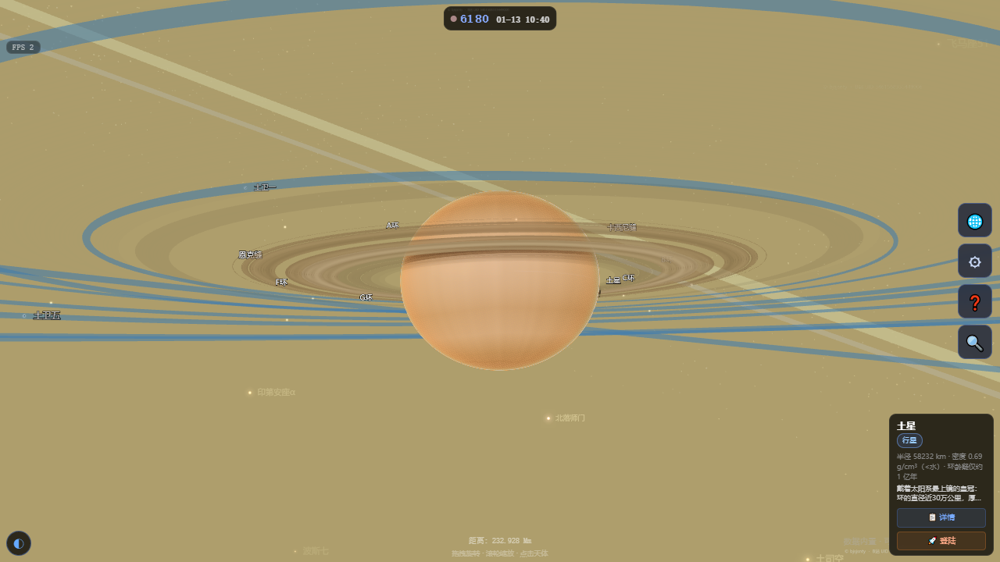

# 太阳系 3D · Solar System 3D

一个**单文件 HTML** 的 3D 太阳系与银河邻居：打开浏览器就能飞，不用安装。


> 在线体验：**https://solar-system-3d-cds.pages.dev**

## 里面有什么

- **475 个天体**：八大行星与卫星、矮行星、主带与柯依伯带小天体、彗星、航天器、近邻恒星、多星系统、系外行星
- **真实轨道**：开普勒要素 + 星历（Standish），支持时间加速/倒放，日期可跳转
- **航天器真实模型**：国际空间站、TESS、旅行者号（gzip 内嵌 GLB）
- **分层三体系统**：南门二（A/B/比邻星）、宝瓶座EZ（Aa/Ab/B）按质量比质心互绕
- **飞行/登陆/锁定视野中心**：飞行到位精确居中（0.000° 实测）
- **相机模式 ⇄ 天体模式**：相机模式方向锁、拖拽只转头；天体模式自由环绕
- **移动端适配**：底部坞站、两列天体列表、FPS 与版权行分层



## 技术要点

| 项 | 做法 |
|---|---|
| 渲染 | three.js 0.186.1（多 CDN 探测 + 只 import 一次，避免多实例） |
| 深度 | float32 hi/lo 模拟双精度对数深度缓冲（reverse-Z） |
| 精度 | 浮动原点（渲染前平移 scene，渲染后还原） |
| 性能 | 分帧建体（每帧 75 颗）、轨道线 LOD、恒星视觉懒加载 |
| 数据 | 约 4 MB 单文件：WebP 贴图、gzip GLB、内嵌审计脚本 |

## 运行

```bash
# 方式一：直接双击
index.html

# 方式二：本地静态服务器
python -m http.server 8080
# 打开 http://localhost:8080
```

> 首次打开需要联网（three.js 从 CDN 加载，五源自动降级）；其余资源全部内嵌。

## 致谢

- 轨道与天体数据来自公开星表、NASA/ESA 文献与公开图像
- three.js 及其 addons（MIT）
- 航天器模型来自 NASA 公开 3D 资源

## License

MIT
