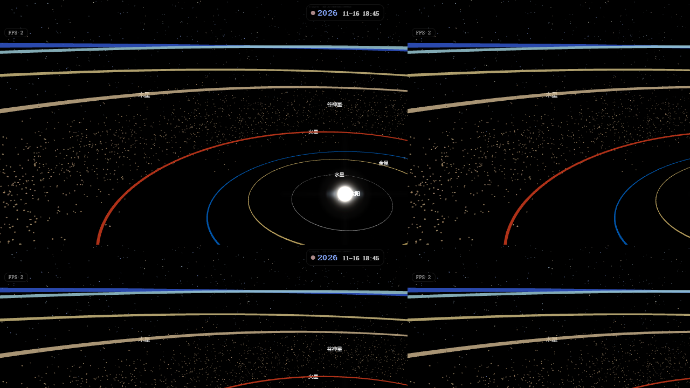

# 太阳系 3D · Solar System 3D

一个**单文件 HTML** 的 3D 太阳系与银河邻居：打开浏览器就能飞，不用安装。

### 🌐 [点我立刻体验 →](https://solar-system-3d-cds.pages.dev/)

> 如果这个项目让你觉得「有点意思」，**点个 Star 是最大的鼓励** ⭐ —— 它会让更多人在 GitHub 上刷到这个单文件宇宙。

> 🤖 **AI 生成声明**
>
> 本项目的**代码、界面文案、天体介绍文字与数据结构**，由作者使用 AI（DeepSeek）辅助生成与迭代；**天体参数**来自 NASA / ESA / SIMBAD / 维基百科等公开资料，并逐条与公开星表核对。
>
> AI 会出错——如果发现**事实错误、数据偏差或文案问题**，欢迎直接开 [Issue](https://github.com/myhhhhhhhhhhhhhhhhhhhhhhh/solar-system-3d/issues) 指出，我会核实后修正。
>
> 作者的角色：定需求、做决策、核对数据、验收效果；AI 的角色：写代码、写文案、查资料、跑测试。

## 里面有什么

- **475 个内置天体**：八大行星与卫星、矮行星、主带与柯依伯带小天体、彗星、航天器、近邻恒星、多星系统、系外行星
  （干净启动时 BODIES 恰为 475 条；若加载结构插件，运行时对象数会相应增加）
- **真实轨道**：开普勒要素 + 星历（Standish），支持时间加速/倒放，日期可跳转
- **航天器真实模型**：国际空间站、TESS、旅行者号（gzip 内嵌 GLB）
- **分层三体系统**：南门二（A/B/比邻星）、宝瓶座EZ（Aa/Ab/B）按质量比质心互绕
- **飞行/登陆/锁定视野中心**：飞行到位精确居中（0.000° 实测）
- **相机模式 ⇄ 天体模式**：相机模式方向锁、拖拽只转头；天体模式自由环绕
- **移动端适配**：底部坞站、两列天体列表、FPS 与版权行分层

## 技术要点

| 项 | 做法 |
|---|---|
| 渲染 | three.js 0.186.1（多 CDN 探测 + 只 import 一次，避免多实例） |
| 深度 | float32 hi/lo 模拟双精度对数深度缓冲（reverse-Z） |
| 精度 | 浮动原点（渲染前平移 scene，渲染后还原） |
| 性能 | 分帧建体（每帧 75 颗）、轨道线 LOD、恒星视觉懒加载 |
| 数据 | 约 4 MB 单文件：WebP 贴图、gzip GLB、内嵌审计脚本 |

## 数据与 AI 说明

- **AI 参与范围**：代码实现、界面文案、天体介绍、数据结构设计、测试脚本
- **人工把关**：需求决策、数据核对、效果验收、错误修正
- **数据来源**：NASA / JPL（星历、小天体）、ESA / Gaia（恒星距离）、SIMBAD、维基百科 / HandWiki、Constellation Guide、NASA Exoplanet Archive
- **已知局限**：少数观测弧段短的天体，轨道参数为展示级近似；恒星参数在不同文献间可能有一两成差异，条目内已注明取值来源
- **纠错**：发现错误请开 Issue，附上出处，我会核对更新
- **计数口径**：`475` 是干净启动时 BODIES 数组的条目数（实测：恒星 85 / 行星 63 / 卫星 150 / 矮行星 15 / 小行星 133 / 彗星 19 / 探测器 4 / 褐矮星 6）。加载结构插件后运行时对象会增加（例如 496），对外文案统一写「475 个内置天体」。

## 运行

下载 `index.html`，**双击即可**——单文件，不需要安装、不需要服务器、不需要构建。

> 个别浏览器对 `file://` 下的模块加载有限制时，才需要放到任意静态服务器上打开（例如 `python3 -m http.server`，端口自己挑一个空闲的）。
>
> 首次打开需要联网（three.js 从 CDN 加载，五源自动降级）；其余资源全部内嵌在 HTML 里。

## 致谢

- 轨道与天体数据来自公开星表、NASA/ESA 文献与公开图像
- three.js 及其 addons（MIT）
- 航天器模型来自 NASA 公开 3D 资源

## License

MIT
